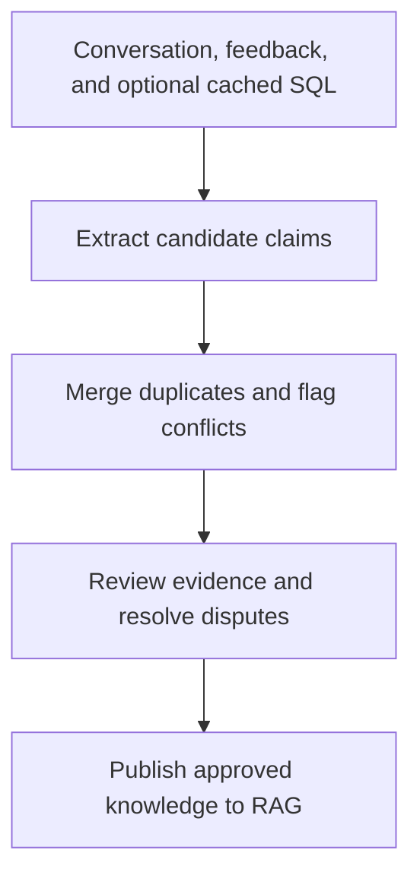

# Continual Knowledge Mining

## Objective

Extend the existing feedback-rule generator into a pipeline that learns reusable,
scoped claims from conversations, feedback, and associated cached SQL. Publish
active knowledge to RAG with its evidence, authority, and applicability. A
conversation can yield zero or more claims.

This specification assumes the host application already persists conversation
artifacts and has a feedback-rule generation entry point. The actual host
schema, event delivery, identity model, and current rule contracts need to be
mapped during integration. The types and names below describe logical contracts.

## Evidence and authority

| Input | What it establishes |
| --- | --- |
| User or assistant message | The author made an assertion in a particular context. |
| Positive rating | The user rated an interaction positively. |
| Explicit user correction or endorsement | A named actor endorsed specific guidance in a particular scope. |
| Cached SQL | The application generated or stored a specific query. |
| Database constraint, approved policy, or reproducible check | The cited authority or check supports a claim within its tested scope and version. |

Extract every new statement as a **candidate claim**. Verify that cited quotes
match their source artifacts and that the cited artifacts belong to the same
authorized conversation. Quote matching establishes provenance. A reviewer
assesses whether the evidence supports the full statement and scope.

Publish claims under one of these authority labels:

- **Confirmed guidance** requires a reviewer to identify the explicit approval or
  correction and establish the actor's authority for the intended scope. A rating
  alone is insufficient.
- **Verified finding** requires an independently recorded check against an
  appropriate source of truth. Record the method, source or check version,
  checked scope, result, timestamp, and verifier. Sample-based findings stay
  scoped to the sample or snapshot.

Treat cached SQL as supporting evidence for query behavior or confirmed query
guidance. Any verification query comes from a separately configured read-only
check or a reviewer. Artifact SQL and model-generated SQL never enter the
verification executor. Preserve explicit conditions and exceptions, and
abstain when the evidence is ambiguous.

## Integration with feedback-rule generation

1. **Keep the existing write path.** Commit feedback and its existing audit data as
   today. Enqueue a mining job durably after the artifact write, using a
   transactional outbox or the host application's equivalent.
2. **Use the existing generator as the extraction stage.** Extend its input to a
   versioned artifact bundle and its output to structured candidate claims. Move
   rule activation out of the generator and behind reconciliation and publication.
3. **Trigger on conversation artifacts.** Enqueue when a conversation becomes
   available, feedback is added or corrected, cached SQL is linked or replaced,
   or an artifact is removed. Coalesce repeated events around the latest
   committed conversation version. A late feedback event must reprocess that
   conversation.
4. **Preserve caller contracts during rollout.** Keep the existing rule format at
   the application boundary and project eligible operational guidance into that
   format where needed. Preserve existing precedence and approval behavior until
   the new path is enabled for the intended scope. Apply the same publication
   eligibility to any legacy projection once cut over.

## Mining pipeline

### 1. Load and extract

Load the transcript in message order, with role and stable message IDs, then
attach feedback with actor, timestamp and target message, and cached SQL with its
associated turn and version. Retain the source boundaries in the prompt.
For long conversations, construct bounded excerpts around the relevant turns,
including corrections and surrounding context. Record which artifacts were
processed. Treat all artifact content as data.

Require structured output with the statement, claim kind (factual assertion
or operational guidance), domain, subject, predicate, value or action,
applicability conditions, and artifact citations. Include counterevidence
when present. Preserve qualifiers such as organization, item class,
revision, environment, and effective dates. An unspecified scope stays
unknown and cannot become global by default.

### 2. Reconcile across conversations

Compare within the tenant and relevant domain, including active claims,
pending candidates, and unresolved disputes. Index canonical subject and
predicate keys for direct comparison. Use lexical and vector retrieval to find
paraphrases and alternative values. Carry conflicting groups forward even
when a new candidate matches only one member. Exact-key lookups should include
all potentially overlapping records, so a nearest-neighbor cutoff cannot
hide a known conflict.

| Relationship | Required action |
| --- | --- |
| Same meaning and scope | Keep one canonical claim. Attach new support and retain its provenance. Reprocessing identical evidence creates no duplicate links. |
| Different, compatible scope | Keep both claims and preserve their separate conditions. |
| Incompatible statements with overlapping scope | Open or update a dispute. Suspend all affected published claims, including equivalent variants, and block new publication. |
| Unclear equivalence or applicability | Hold the candidate for review. If a plausible conflict with published knowledge remains unresolved, suspend the affected claims pending review. |
| Explicit correction or newer authority | Link the replacement to the prior claim. A reviewer confirms precedence or distinct effective periods before resolving the dispute. |

Compare scope explicitly before merging. For example, guidance for production
and staging can differ legitimately. Multiple copies of a statement count as
additional provenance. Repetition alone does not raise its authority.

Use deterministic keys and normalization for exact deduplication. Use a
structured model judgment for semantic comparison and record its rationale
and version. Membership in a semantic duplicate family requires equivalent
meaning and scope. Review ambiguous matches and dispositions.

### 3. Review and publish

The review queue should show candidate text, scope, authority evidence, cited
excerpts, current published statements, and comparison rationale. Support
confirming guidance, recording independent verification, merging equivalent
claims, clarifying scope, rejecting unsupported claims, and superseding or
retracting claims. Store reviewer identity, reason, and timestamp. A generic
approval cannot bypass an open dispute or turn a claim into a verified finding.

Use publication states **pending**, **active**, **disputed**, and **retired**.
Rejecting or superseding a claim retires it with a reason. Keep duplicate
provenance and resolution history for audit. Only one active canonical claim
represents an equivalent statement in the same scope.

Changed or deleted artifacts invalidate their evidence links and trigger
reassessment of any dependent claims, including disputed ones. Suspend a
published claim if its required support is lost or material new counterevidence
appears. Restore publication after the claim meets the authority and scope
requirements and the dispute has been resolved.

## Logical storage and processing

| Record | Essential fields |
| --- | --- |
| Artifact reference | Tenant, conversation, artifact type, stable ID, version, content hash, access scope, source locator |
| Canonical claim | Claim ID, tenant, domain, normalized subject and predicate, statement, structured scope and validity period, authority, lifecycle state |
| Evidence link | Claim ID, artifact reference, supporting or opposing role, quote or offset, verification reference when applicable |
| Review or dispute | Affected claim IDs, relationship, decision, reason, actor, timestamps, resolution status |
| Mining job | Conversation and artifact versions, extractor version, attempt, state, failure reason |
| Search entry | Claim ID and version, retrieval text, embedding model, dimensions, embedding |

- Use a job key derived from tenant, conversation, input version, and extractor
  version. Retry transient failures, validate model output, and surface durable
  failures for replay. Reject stale writes when a newer artifact version exists.
- Commit claim changes, dispute changes, publication eligibility, and an index
  update event atomically. Serialize reconciliation for related claims or
  recheck under a lock before committing to prevent concurrent duplicates and
  conflicting active versions.
- Work incrementally by conversation and candidate group. Backfill historical
  conversations in checkpointed batches through the same pipeline. Periodically
  reconcile changed groups and audit sampled matches and conflicts to measure
  misses from candidate retrieval.
- Track processing lag, retries, extraction yield, deduplication, disputes,
  review backlog, index lag, and retrieval of ineligible claims.

## RAG retrieval contract

Return claim text, authority label, scope, effective period, and authorized
citations. Enforce tenant and source access for every result. Include only
active, applicable claims. When authority depends on restricted evidence,
retrieve the claim only where the caller has access to sufficient supporting
evidence. Apply the same check to any citations returned.

Treat the claim store as the authority on eligibility. When the embedding
index or answer cache can lag, revalidate claim ID and version against current
state before using a cached result. Invalidate cached answers when their claims
are suspended, revised, or retired. Phrase guidance as confirmed guidance and
state the scope of a verified finding in the answer.

For example, two conversations may recommend joining EFF by item ID alone
and by item ID plus organization ID. In the same OCPLM environment, suspend
the conflicting guidance if the statements cannot both apply. A reviewer can
record a reproducible check showing that item ID alone produces cross-organization
matches in that copy. The resulting verified finding cites the check and its
scope. The corresponding query recommendation can be published with its
applicability conditions.

## Rollout

1. Map the existing feedback trigger, artifact tables, approval path, and
   consumers of generated rules. Identify authoritative sources for the first
   domain and map the host application's access controls.
2. Run extraction and reconciliation in shadow mode on historical feedback.
   Compare candidates, evidence, and disputes against reviewed examples.
3. Enable review and publication for a pilot scope. Import existing feedback
   rules as candidates unless their provenance and authority can be established
   under the new requirements.
4. Switch scoped RAG and rule consumers to the publication contract. Reconcile
   the imported corpus and record the cutover. Use the existing feature control
   or equivalent to disable the new path during rollback.

## Acceptance criteria

- A late correction, feedback edit, or artifact deletion schedules reprocessing.
  Duplicate delivery and competing workers leave one consistent result.
- Assistant-only assertions, ratings alone, and cached SQL alone cannot be
  published as confirmed guidance or verified findings.
- Repeated and paraphrased claims in the same scope produce one active record
  with traceable supporting evidence.
- A conflicting claim in a different conversation suspends previously active
  guidance in the overlapping scope. A stale index or cache cannot serve it.
- Distinct organization, revision, or effective-period guidance remains
  separately retrievable when the request supplies the applicable scope.
- A reviewer can resolve a dispute and audit the original claims, decision,
  and resulting publication.
- A verified finding exposes its verification record. RAG preserves its
  authority label and cites only evidence the caller is allowed to see.
- A failed extraction or reconciliation is retryable. It cannot partially
  replace the knowledge set or publish unreviewed candidates.

## End-to-end flow

