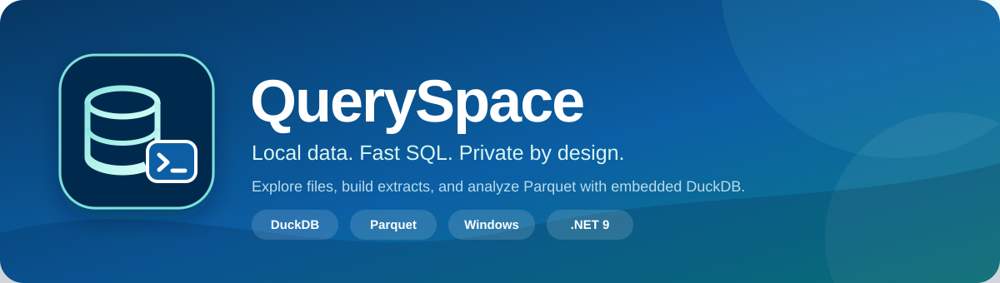
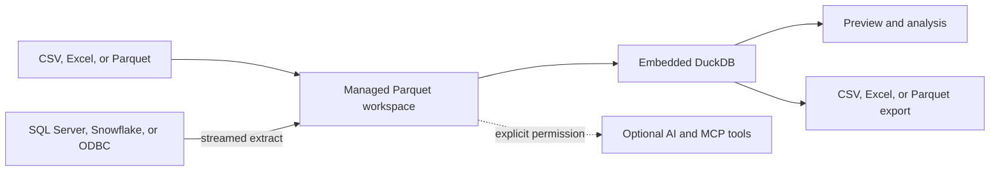

<p align="center">
  
</p>

<p align="center">
  <strong>A local-first SQL workspace for files, Parquet datasets, and database extracts.</strong>
</p>

<p align="center">
  Import data, build reliable extracts, query with DuckDB, and export results without running a separate database server.
</p>

<p align="center">
  <a href="https://github.com/kiranrajpv/queryspace-open/blob/main/LICENSE"></a>
  
  
  
  
</p>

<p align="center">
  <a href="#why-queryspace">Why QuerySpace</a> ·
  <a href="#quick-start">Quick Start</a> ·
  <a href="#main-features">Features</a> ·
  <a href="#optional-ai-assistant">AI Assistant</a> ·
  <a href="#mcp-integration">MCP</a> ·
  <a href="#build-from-source">Build</a> ·
  <a href="#technology-and-dependencies">Dependencies</a> ·
  <a href="#security-notes">Security</a>
</p>

## Why QuerySpace

QuerySpace keeps analytical work simple and close to the data.

- **Local-first by default.** Files and query results stay on the computer unless the user explicitly connects to an external service.
- **Parquet-native workflows.** Imports and database extracts become predictable, reusable Parquet datasets.
- **One focused workspace.** Data discovery, SQL editing, extraction, validation, export, and optional AI tools live in one Windows application.

> [!NOTE]
> QuerySpace does not require a separate DuckDB server. DuckDB runs inside the application, and the self-contained installer includes the required .NET runtime.

## What you can do

- Query Parquet datasets locally with DuckDB SQL.
- Import CSV, Excel, and Parquet files into a managed workspace.
- Extract large database results directly into compressed Parquet row groups.
- Connect to SQL Server, Snowflake, and ODBC data sources.
- Edit SQL with syntax highlighting, autocomplete, snippets, and multiple tabs.
- Browse datasets, scripts, templates, connections, and in-memory DuckDB objects.
- Export results to CSV, Excel, or Parquet.
- Run data-quality and source-to-target transformation checks.
- Use optional local or cloud AI models with permission-controlled tools.
- Expose approved datasets to compatible MCP clients through a read-only server.

## How it works



## Platform

| Requirement | Details |
|---|---|
| Operating system | Windows 10 or Windows 11, 64-bit |
| Runtime | Included in the self-contained installer |
| Source build | .NET 9 SDK |
| Installer build | Inno Setup 6 |

QuerySpace is currently a Windows-only WPF application.

## Quick start

1. Install and open QuerySpace.
2. Select **Set Workspace** and choose a folder.
3. Import a CSV, Excel, or Parquet file.
4. Select the dataset in **Local Datasets**.
5. Run a query:

   ```sql
   select *
   from your_dataset
   limit 100;
   ```

6. Save the SQL or export the result when needed.

## Workspace layout

QuerySpace keeps user data separate from the installed application.

```text
workspace\
├── datasets\       Managed Parquet datasets
├── exports\        Exported query results
├── queries\        Saved SQL scripts
├── connections\    Connection definitions and saved extract queries
└── settings.json    Workspace settings
```

Dataset names are unique. QuerySpace will not overwrite an existing dataset. Delete the existing dataset or choose a different name.

## Main features

### Local datasets

- Imports CSV, `.xls`, `.xlsx`, and Parquet files.
- Stores managed datasets as `datasets\<dataset_name>.parquet`.
- Handles quoted CSV fields, including values that contain commas.
- Converts common null markers such as `#N/A`, `#VALUE!`, `NULL`, and blank values.
- Shows row count, file size, schema, and storage information.
- Renames the physical Parquet file when a dataset is renamed.

### SQL workspace

- Uses DuckDB for local analytical SQL.
- Supports multiple query tabs and saved SQL scripts.
- Provides syntax highlighting, line numbers, autocomplete, and DuckDB snippets.
- Supports session tables, views, macros, indexes, sequences, and schemas.
- Shows preview results without loading every row into the UI.
- Runs up to three saved scripts at the same time and queues additional scripts.

### Import, extraction, and export

- Streams database extracts directly into Zstandard-compressed Parquet row groups.
- Uses a default batch size of 250,000 rows.
- Shows progress and supports cancellation.
- Writes to a temporary `.partial` file and keeps the final file only after success.
- Exports results to CSV, Excel, or Parquet.
- Streams CSV and Parquet exports for large results.
- Limits Excel output to the Excel worksheet limit of 1,048,576 rows.

### Database connections

| Source | Driver used by QuerySpace | Notes |
|---|---|---|
| SQL Server | `Microsoft.Data.SqlClient` | Supports Windows authentication, SQL authentication, encryption, and trusted server certificates. |
| Snowflake | `Snowflake.Data` | Supports password, Programmatic Access Token (PAT), OAuth token, and optional proxy settings. |
| ODBC | Windows 64-bit ODBC | Supports configured DSNs when the required 64-bit vendor driver is installed. |

Database drivers and servers are not bundled unless listed in the dependency table below. Vendor-specific client software must be installed and licensed separately.

### Data quality and transformation validation

QuerySpace can calculate:

- Row and column counts.
- Null percentages.
- Unique-value counts.
- Numeric outlier indicators.
- Duplicate business keys.
- Source-to-target value changes.
- Numeric and date drift.
- Leading-zero, case, and whitespace changes.
- Missing, expired, defaulted, or mismatched cross-reference values.
- Pre-load to post-load mismatches.

The **Templates** panel contains starting queries for:

1. Source extraction.
2. Transformation and pre-load validation.
3. Post-load validation.

<details>
<summary><strong>View a tagged source-to-target validation example</strong></summary>

Tagged SQL tells QuerySpace how returned columns should be compared:

```sql
-- @analysis: source-target-validation
-- @source: source_data
-- @target: transformed_data
-- @postload: loaded_data
-- @xref: reference_data
-- @keys: source_item_id
-- @compare: source_item_id=transformed_item_id, source_unit=transformed_unit
-- @xref-values: transformed_item_id=xref_target_item_id
-- @rules: null-introduced, value-changed, xref-missing, postload-mismatch

select
    source.item_id as source_item_id,
    source.unit as source_unit,
    target.item_id as transformed_item_id,
    target.unit as transformed_unit,
    xref.target_item_id as xref_target_item_id,
    loaded.item_id as loaded_item_id
from source_data source
left join reference_data xref
    on source.item_id = xref.source_item_id
left join transformed_data target
    on xref.target_item_id = target.item_id
left join loaded_data loaded
    on target.item_id = loaded.item_id;
```

</details>

## Optional AI assistant

The AI assistant is optional. Core import, extraction, DuckDB, and Parquet features work without it.

QuerySpace supports:

- Local models through Microsoft Foundry Local.
- OpenAI.
- Azure OpenAI.
- OpenAI-compatible endpoints.
- Streaming responses and cancellation.
- Dataset, schema, sampling, read-only SQL, and editor tools.

Local models are downloaded only after user approval. Model weights have their own publisher licenses and are not included with QuerySpace.

### AI permissions

AI and MCP access is disabled by default. Access requires:

1. Enabling the master AI/MCP setting.
2. Enabling the required tool permissions.
3. Marking each allowed dataset as **Available to MCP / AI**.

SQL execution is read-only, row-limited, time-limited, and restricted to approved datasets. Editor reads and writes have separate permissions. Optional audit records do not contain cloud API keys.

### Local application data

```text
%LOCALAPPDATA%\QuerySpace\ai-settings.json   AI configuration
%LOCALAPPDATA%\QuerySpace\.ai-secrets\      DPAPI-encrypted cloud secrets
%LOCALAPPDATA%\QuerySpace\models\           Downloaded local models
%LOCALAPPDATA%\QuerySpace\audit\            Optional tool audit records
```

Passwords and tokens are encrypted with Windows DPAPI for the current Windows user.

## MCP integration

`QuerySpace.McpServer` is a read-only stdio server for compatible MCP clients. It provides tools to:

- List approved datasets.
- Read dataset schemas.
- Sample approved datasets.
- List and read SQL scripts when permitted.
- Run bounded, read-only DuckDB queries when permitted.

The server does not expose dataset paths, connection details, or saved secrets.

Example development configuration for `.vscode/mcp.json`:

```json
{
  "servers": {
    "queryspace": {
      "type": "stdio",
      "command": "dotnet",
      "args": [
        "run",
        "--project",
        "${workspaceFolder}\\src\\QuerySpace.McpServer\\QuerySpace.McpServer.csproj"
      ]
    }
  }
}
```

For an installed application, use the packaged executable:

```json
{
  "servers": {
    "queryspace": {
      "type": "stdio",
      "command": "C:\\Program Files\\QuerySpace\\mcp\\QuerySpace.McpServer.exe"
    }
  }
}
```

## Build from source

Clone the repository and open PowerShell in the project root:

```powershell
git clone <repository-url>
cd queryspace-open
dotnet restore .\QuerySpace.sln
dotnet build .\QuerySpace.sln -c Release
```

Run the application:

```powershell
dotnet run --project .\src\QuerySpace\QuerySpace.csproj -c Release
```

## Publish

Create a self-contained Windows application folder without building the installer:

```powershell
.\scripts\build-installer.ps1 -SkipInstaller
```

Output:

```text
.\publish\QuerySpace\QuerySpace.exe
```

## Build the installer

Install [Inno Setup 6](https://jrsoftware.org/isinfo.php), then run:

```powershell
.\scripts\build-installer.ps1
```

Output:

```text
.\installer-output\QuerySpace-Setup-<version>.exe
```

Use `-FrameworkDependent` only when the target computers already have the required .NET Desktop Runtime.

## Repository structure

```text
src\QuerySpace\             WPF desktop application
src\QuerySpace.McpServer\   Read-only MCP server
src\QuerySpace\Assets\      Application assets
src\QuerySpace\Templates\   Built-in SQL templates
installer\                  Inno Setup project
scripts\                    Build and license scripts
```

## Technology and dependencies

The following tables list direct project dependencies. Transitive packages and package-provided license text are recorded in [THIRD-PARTY-NOTICES.md](THIRD-PARTY-NOTICES.md).

### Platform and build tools

| Technology | License or owner | Use |
|---|---|---|
| C# and .NET 9 | MIT; Microsoft and .NET Foundation | Application language, runtime, and build system. |
| WPF | MIT; Microsoft and .NET Foundation | Native Windows user interface. |
| Windows DPAPI | Microsoft Windows | Encrypts saved credentials for the current user. |
| Windows ODBC | Microsoft Windows | Connects to configured 64-bit ODBC data sources. |
| Git | GPL-2.0 | Source control. |
| NuGet | Apache-2.0 | .NET package management. |
| Inno Setup 6 | Inno Setup License | Creates the Windows installer. |

### Desktop application packages

| Package | Version | License | Use |
|---|---:|---|---|
| `AvalonEdit` | 6.3.1.120 | MIT | SQL editor, highlighting, and autocomplete. |
| `DuckDB.NET.Data.Full` | 1.5.3 | MIT | Embedded DuckDB engine and ADO.NET provider. |
| `ExcelDataReader` | 3.9.0 | MIT | Reads `.xls` and `.xlsx` files. |
| `Microsoft.Data.SqlClient` | 7.0.2 | MIT | SQL Server connections. |
| `Microsoft.AI.Foundry.Local` | 2.0.1 | MIT | Optional local model discovery and inference. |
| `Microsoft.Agents.AI` | 1.22.0 | MIT | AI agent and conversation abstractions. |
| `Microsoft.Agents.AI.Harness` | 1.22.0 | MIT | AI tool orchestration and session handling. |
| `Microsoft.Extensions.AI` | 10.10.0 | MIT | Common AI messages, clients, and tools. |
| `Parquet.Net` | 6.0.3 | MIT | Streams database extracts into Parquet row groups. |
| `Snowflake.Data` | 5.7.0 | Apache-2.0 | Snowflake connectivity. |
| `System.Data.Odbc` | 9.0.7 | .NET library license | ODBC connectivity. |
| `System.Management` | 9.0.13 | MIT | Detects Windows GPU adapters. |
| `System.Security.Cryptography.ProtectedData` | 9.0.13 | MIT | Windows DPAPI support. |

### MCP server packages

| Package | Version | License | Use |
|---|---:|---|---|
| `DuckDB.NET.Data.Full` | 1.5.3 | MIT | Restricted SQL over approved Parquet datasets. |
| `Microsoft.Extensions.Hosting` | 9.0.7 | MIT | MCP process hosting and lifetime management. |
| `ModelContextProtocol` | 1.4.1 | Apache-2.0 | MCP server implementation. |

### External components

| Component | Included? | Notes |
|---|---:|---|
| SQL Server | No | Requires access to a licensed SQL Server instance. |
| Vendor ODBC drivers | No | Install separately under the database vendor's terms. |
| Snowflake account and credentials | No | Requires a Snowflake account and approved authentication method. |
| Local model weights | No | Downloaded after approval and governed by each model publisher's license. |

## Dependency and license maintenance

Run these commands before creating a release:

```powershell
dotnet restore .\QuerySpace.sln
dotnet list .\src\QuerySpace\QuerySpace.csproj package --include-transitive
dotnet list .\src\QuerySpace\QuerySpace.csproj package --vulnerable --include-transitive
dotnet list .\src\QuerySpace\QuerySpace.csproj package --outdated
.\scripts\generate-third-party-notices.ps1
```

The dependency tables are an engineering inventory, not legal advice. Review the exact release output and [THIRD-PARTY-NOTICES.md](THIRD-PARTY-NOTICES.md) with the appropriate legal or compliance team before external distribution.

## Security notes

- QuerySpace has no local HTTP backend.
- Credentials are not stored in source files or workspace connection files.
- Failed or cancelled extracts remove incomplete output files.
- External MCP access is read-only and follows the configured permissions.
- Cloud AI sends only the requested context and approved tool results to the configured provider.
- Vendor-specific database clients are not bundled unless listed as direct dependencies.

## License

See [LICENSE](LICENSE) for the QuerySpace project license and [THIRD-PARTY-NOTICES.md](THIRD-PARTY-NOTICES.md) for third-party license information.
